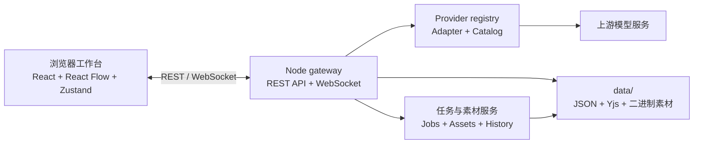

# Continuum Canvas

> **Continuum 连点成片** 是一个面向 AI 影视与视觉创作的本地优先无限画布工作台。它把素材整理、提示词编排、模型生成、画布协作与项目持久化放在同一个可自托管的工作流中。

[](https://nodejs.org/)
[](https://react.dev/)
[](https://www.typescriptlang.org/)
[](https://reactflow.dev/)
[](https://docs.yjs.dev/)

> 当前版本处于 **Pre-1.0 / Active Development** 阶段。接口、数据格式和 UI 仍可能演进，生产部署前请固定提交版本并备份数据目录。

## 项目定位

Continuum Canvas 采用“浏览器工作台 + 单实例 Node gateway”的结构：

- 浏览器负责无限画布、节点交互、项目状态和本地 UI 偏好。
- gateway 负责 API、素材文件、生成任务、模型目录、供应商配置和 WebSocket 协作。
- 运行数据默认保存在项目根目录下、已被 Git 忽略的 `data/` 目录，适合个人工作站、家庭服务器和受控局域网部署。
- 供应商通过 adapter 接入，API 密钥只在 gateway 侧使用，前端只接收能力和掩码状态。

## 主要能力

| 能力 | 说明 |
| --- | --- |
| 无限画布 | 基于 React Flow 的节点、连线、分组、缩放、选区、吸附和图层编辑。 |
| 素材工作流 | 支持图片/视频节点、素材管理、引用关系、缩略图和本地持久化。 |
| AI 生成 | 统一的 provider registry、模型目录同步、图像/视频生成任务和历史记录。 |
| 多供应商 | 通过适配器连接 OpenAI-compatible、AIStartLab、ComfyUI、DashScope、Kling、MiniMax 等服务。 |
| 多人协作 | 基于 Yjs + WebSocket 的房间协作，支持房主、编辑者和查看者角色。 |
| Agent 集成 | 可配置多个 OpenAI-compatible LLM，为画布任务提供 Agent 对话和工具调用。 |
| 本地优先 | IndexedDB 保存浏览器状态，gateway 将项目、任务、素材和协作快照写入磁盘。 |

## 系统架构



### 技术栈

| 层次 | 技术 |
| --- | --- |
| UI | React 19、TypeScript、Vite、Lucide React |
| 画布 | `@xyflow/react`、自定义节点/边/吸附与视口同步 |
| 状态 | Zustand、IndexedDB（`idb`） |
| 协作 | Yjs、`y-protocols`、Node `ws` |
| 服务端 | Node.js 22、原生 HTTP、TypeScript 运行时入口 |
| 测试与质量 | Vitest、Testing Library、Playwright、oxlint |

## 快速开始

### 环境要求

- Node.js **22.18.0 或更高版本**
- npm **10 或更高版本**
- Git

### 安装与开发

```bash
git clone https://github.com/wcmmsmztchbfx-ctrl/Continuum-canvas.git
cd Continuum-canvas
npm ci
npm run dev
```

开发模式会同时启动：

- 前端：<http://127.0.0.1:4173>
- gateway：<http://127.0.0.1:4174>
- 健康检查：<http://127.0.0.1:4174/api/health>

示例画布地址：

```text
http://127.0.0.1:4173/canvas?spaceId=local&projectId=reference
```

### 配置供应商密钥

默认配置文件为 `data/secrets.env`。也可以继续使用旧部署中的 `.env.local`，但新部署建议将密钥文件放在 `data/` 下：

Windows PowerShell：

```powershell
New-Item -ItemType Directory -Force data | Out-Null
Copy-Item .env.example data/secrets.env
```

macOS / Linux：

```bash
mkdir -p data
cp .env.example data/secrets.env
```

配置文件和 `data/` 已被 `.gitignore` 排除。请只在本地或部署平台的 secret manager 中填写真实密钥。

### 生产运行

```bash
npm ci
npm run build
npm start
```

`npm start` 使用 gateway 提供 `dist/` 静态文件，默认监听 `http://127.0.0.1:4173`。生产模式不需要单独启动 Vite。

生产模式还会启动一个只绑定回环地址的管理入口 `http://127.0.0.1:5172`；它与主入口共享服务端数据，但不会接受局域网连接。管理入口不额外要求账号密码，边界由回环地址和端口本身提供。

主入口 `4173` 面向协作者只提供画布与协作 API；其中“更多设置”仅保留语言和版本信息。存储、启动、运行模式、缓存和更新操作只在 `5172` 管理入口显示。

### 后台开发服务

```bash
npm run dev:service
node scripts/dev-service.mjs status
node scripts/dev-service.mjs stop
```

开发服务会输出本机地址和检测到的局域网分享地址；如果其他设备无法连接，请检查主机防火墙的 TCP `4173` 端口。

## 配置参考

配置文件路径可通过 `CANVAS_ENV_FILE` 指定；默认是 `data/secrets.env`。为兼容旧项目，`.env.local` 仍会被读取。除特别注明外，路径均相对于项目根目录解析。

| 变量 | 默认值 | 用途 |
| --- | --- | --- |
| `CANVAS_ENV_FILE` | `data/secrets.env` | gateway 使用的环境文件 |
| `CANVAS_DATA_DIR` | `data` | 项目、任务、素材和协作数据目录 |
| `CANVAS_GATEWAY_HOST` | `127.0.0.1` | gateway 监听地址 |
| `CANVAS_GATEWAY_PORT` | 开发 `4174`，生产 `4173` | gateway 监听端口；兼容 `GATEWAY_PORT` |
| `CANVAS_ADMIN_PORT` | `5172` | 只绑定 `127.0.0.1` 的管理入口；可改为其他未占用端口 |
| `CANVAS_OPERATION_MODE` | 已保存设置，首次为 `solo` | 启动默认模式：`solo`、`host`（服务器模式兼容值）或 `workstation` |
| `CANVAS_VITE_HOST` | `127.0.0.1` | Vite 开发服务器监听地址 |
| `CANVAS_GATEWAY_ORIGIN` | `http://127.0.0.1:4174` | Vite `/api` 与 WebSocket 代理目标 |
| `CANVAS_ASSET_IMPORT_TIMEOUT_MS` | `90000` | 远程素材导入超时，最大 `600000` |
| `CANVAS_GENERATION_MAX_RUN_TIME_MS` | `1800000` | 单个生成任务跟踪时限，范围 1 分钟至 24 小时 |
| `CANVAS_DOH_ENDPOINT` | 未设置 | 可选的 DNS-over-HTTPS resolver |
| `CANVAS_ALLOW_INSECURE_LAN` | 未设置 | 允许私有局域网地址使用 HTTP 协作 |
| `CANVAS_PUBLIC_ORIGIN` | 未设置 | 浏览器访问 gateway 的公开 Origin |
| `CANVAS_ALLOWED_ORIGINS` | 未设置 | 允许的 HTTP/WebSocket Origin，逗号分隔 |
| `API_PROVIDER_<ID>_KEY` | 未设置 | 生成供应商密钥，例如 `API_PROVIDER_AISTARTLAB_KEY` |
| `AGENT_LLM_<ID>_KEY` | 未设置 | Agent LLM 密钥，例如 `AGENT_LLM_DEEPSEEK_KEY` |

密钥变量中的 `<ID>` 来自 provider 记录的 ID，并转换为大写下划线形式。供应商 API 密钥不会通过前端 API 返回明文，只返回是否已配置和掩码。

## 局域网与公网协作

### 受控局域网（HTTP）

将以下内容写入 `data/secrets.env`，把示例地址替换为运行主机的实际私网地址：

```dotenv
CANVAS_VITE_HOST=0.0.0.0
CANVAS_GATEWAY_HOST=0.0.0.0
CANVAS_ALLOW_INSECURE_LAN=true
CANVAS_PUBLIC_ORIGIN=http://192.168.1.50:4173
CANVAS_ALLOWED_ORIGINS=http://192.168.1.50:4173,http://127.0.0.1:4173,http://localhost:4173
```

然后重新运行 `npm run dev`。开发模式下浏览器访问 `4173`，该端口会把 `/api` 和协作 WebSocket 代理到 `4174`；通常只需要在防火墙放行 TCP `4173`。

`CANVAS_ALLOW_INSECURE_LAN=true` 只适用于 RFC 1918/链路本地等私有地址。不要把这种 HTTP 配置直接暴露到互联网。

### HTTPS 反向代理

公网部署必须使用 HTTPS：

```dotenv
CANVAS_GATEWAY_HOST=127.0.0.1
CANVAS_PUBLIC_ORIGIN=https://canvas.example.com
CANVAS_ALLOWED_ORIGINS=https://canvas.example.com
```

反向代理应将静态页面、`/api` 和 `/api/collaboration/ws` 转发到同一个 gateway，并保留 WebSocket 的 `Upgrade` / `Connection` 头。不要直接暴露 `data/`、协作快照或素材目录。

### 三种运行模式

运行模式由服务端保存，UI 中显示为“个人模式”“服务器模式”和“工作站模式”。`host` 仍作为旧部署的兼容线格式值，但产品文案统一使用“服务器模式”。

- **个人模式（`solo`）**：本机单用户工作区，不要求昵称，不自动开放局域网协作。画布邀请仍可按画布建立编辑者/查看者会话。
- **服务器模式（`host`）**：访问者先输入昵称，画布协作由 gateway 中继；编辑者和查看者通过房间会话获得对应权限。
- **工作站模式（`workstation`）**：访问者先输入昵称，每个昵称映射到 `CANVAS_DATA_DIR/workstation/<user-id>/` 独立工作区。不同用户看不到彼此的工作区；用户可在自己的画布上配置 API，并按画布邀请协作者。

API 配置以 `projectId + canvasId` 为作用域，密钥保存在服务端的画布侧边文件中。未加入房间的远程访问者不能写入；房间查看者不能修改，编辑者可以修改当前授权画布的供应商与 Agent API 配置。WebSocket/Yjs 中继架构在三种模式下保持不变。

当前协作实现适用于单实例自托管，默认最多 10 个活跃客户端。房间快照、增量更新、成员和邀请元数据保存在 `CANVAS_DATA_DIR/collaboration`；专用管理入口用于本机查看和调整运行设置。

当前版本不提供中心账号、跨实例联邦或水平扩展。多个 gateway 不应同时写入同一个数据目录。

## 供应商适配器

`server/providers/` 当前包含以下可运行的适配器类型：

| Adapter type | 典型用途 |
| --- | --- |
| `aistartlab-openapi` | AIStartLab OpenAPI |
| `openai-compatible` | OpenAI、DeepSeek、硅基流动及其他兼容接口 |
| `minimax-video` | MiniMax 视频服务 |
| `runninghub-api` | RunningHub |
| `volcengine-ark` | 火山引擎方舟 |
| `modelscope-api` | ModelScope |
| `jimeng-cli` | 即梦 CLI |
| `dashscope-api` | 阿里云百炼 / DashScope |
| `kling-api` | 可灵 |
| `comfyui-direct` | 自托管 ComfyUI |

适配器类型存在不代表上游账号、模型或计费权限已经可用。实际可用性由 endpoint、密钥、模型目录和上游服务状态共同决定。新增适配器时，通常需要同时更新：

- `server/providers/provider-adapter.ts`
- `server/runtime.ts`
- `src/contracts/catalog.ts`
- 对应的服务端测试和目录解析逻辑

## 数据目录与备份

默认 `data/` 目录包含运行时数据，典型结构如下：

```text
data/
├─ secrets.env                    # 密钥；不要提交
├─ providers.json                 # 生成供应商配置
├─ agent-providers.json           # Agent LLM 配置
├─ catalog-cache.json             # 模型目录缓存
├─ jobs.json                      # 生成任务与恢复信息
├─ generation-history/            # 生成历史
├─ workspace/                     # 工作区清单
├─ canvases/                      # 画布快照与 Agent 会话
├─ workstation/<user-id>/         # 工作站模式的用户隔离工作区
├─ canvas-providers/<scope-hash>/ # 画布级供应商、目录与 Agent 配置
├─ collaboration/                # Yjs 房间快照、日志和成员元数据
├─ assets/                        # 素材索引与二进制文件
└─ .backend.lock                 # 单 gateway 数据目录锁
```

升级、迁移或切换主机前，请备份整个 `CANVAS_DATA_DIR`。运行时数据、密钥、上传素材和邀请信息都不应进入 Git；仓库只提交不含真实值的 `.env.example`。

## 验证与测试

```bash
# 静态检查与生产构建
npm run lint
npm run build

# 单元测试
npm test
npm run test:server

# 端到端测试（需要已安装 Playwright 浏览器）
npm run test:e2e
```

视觉参考与测量说明位于 `tests/visual/` 和 `docs/reference-matrix.md`；架构索引见 `PROJECT_INDEX.md`。

## 常见问题

### 局域网设备无法打开页面

确认服务绑定到了 `0.0.0.0`、`CANVAS_PUBLIC_ORIGIN` 使用实际私网地址，并在主机防火墙放行 TCP `4173`。不要把旧的 `127.0.0.1` 邀请链接发给其他设备。

### 模型目录加载失败

检查 provider 是否启用、适配器类型是否受支持、对应密钥是否已配置，并在设置中重新同步目录。目录是带有效期的能力/价格缓存，不能替代上游最新报价。

### 启动时提示数据目录被占用

同一 `CANVAS_DATA_DIR` 同时只能运行一个 gateway。先停止旧进程，确认 `.backend.lock` 对应的进程已经退出，再启动新实例；不要让多个实例并发写同一目录。

## 贡献指南

欢迎提交 bug、适配器、测试和文档改进。建议流程：

1. 从最新分支创建主题分支。
2. 保持修改范围聚焦，并为行为变化补充测试。
3. 提交前运行 `npm run lint`、`npm test`、`npm run test:server` 和 `npm run build`。
4. 在 Pull Request 中说明变更目的、验证方式以及是否涉及数据迁移。

## 许可证

仓库当前未包含许可证文件。进行生产部署、再分发或闭源集成前，请先确认项目维护者提供的授权条款。
