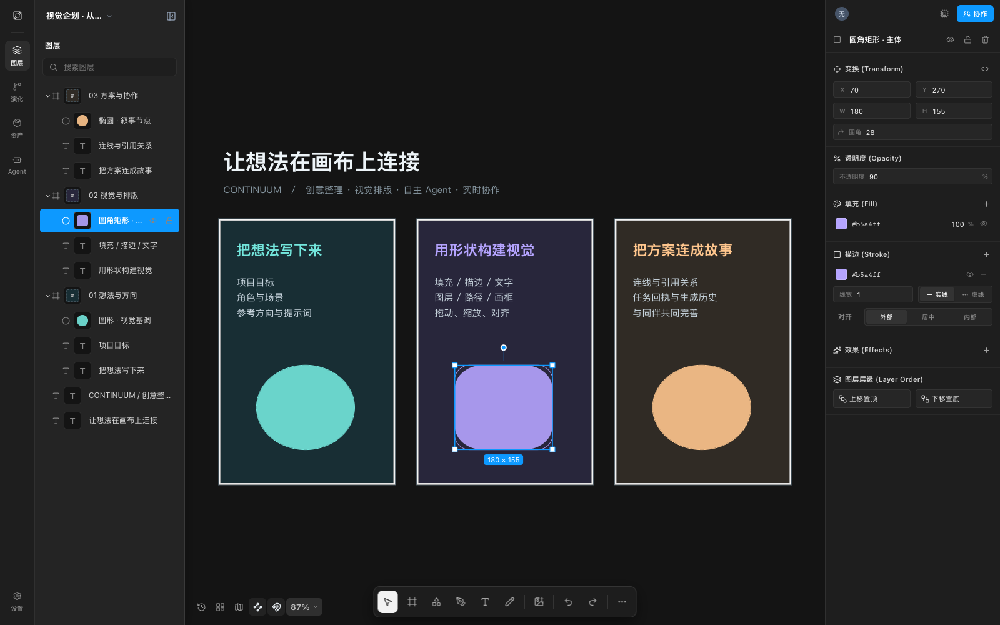
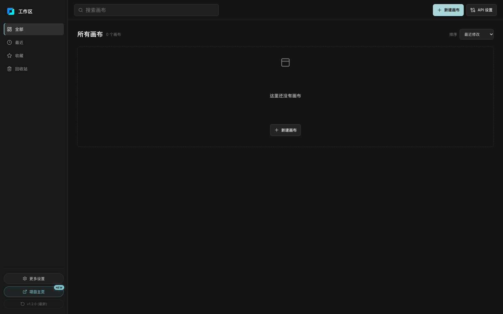

<p align="center">
  
</p>
<h1 align="center">Continuum · 连点成片</h1>
<p align="center"><strong>把想法、素材、提示词与 AI 生成过程，组织在同一张无限画布里。</strong></p>
<p align="center">可自托管 · 图片与视频创作 · 矢量编辑 · 画布 Agent · 实时协作</p>
<p align="center">
  <a href="#一键启动">一键启动</a> ·
  <a href="#第一次使用">第一次使用</a> ·
  <a href="#功能总览">功能总览</a> ·
  <a href="#画布-agent">画布 Agent</a> ·
  <a href="#部署与协作分享">部署与协作分享</a> ·
  <a href="#常见问题">常见问题</a> ·
  <a href="./LICENSE">MIT 许可</a>
</p>

Continuum 是一个可自托管的 AI 视觉创作工作台。它把节点式素材组织、图片与视频生成、矢量排版和协作编辑放在同一个项目中：你可以手动编辑，也可以让 Agent 根据自然语言操作画布。

它适合用来整理视觉参考、规划角色与场景、搭建分镜、批量准备提示词，或者与同伴共同推进一份视觉方案。画布和服务端数据保存在你部署的机器上；调用外部模型时，相应的提示词与参考素材会发送给所配置的服务。

**不配置模型也能使用手工画布。** AI 对话、图片生成和视频生成需要分别接入相应服务。本项目不附带模型额度、API Key 或商用素材。



<p align="center"><sub>实际界面截图，示例内容仅使用自建文字与几何图形。</sub></p>

## 一键启动

### 1. 安装运行环境（只需一次）

从 [Node.js 官方下载页](https://nodejs.org/en/download) 安装受支持的 **LTS 版本**，最低要求为 **Node.js 22.18.0、npm 10**。npm 随 Node.js 一起安装。安装后重新打开终端；无需安装 Python、数据库或 Docker。

### 2. 获取完整源码

在 GitHub 仓库页面选择 **Code → Download ZIP**，下载后**完整解压**到一个可写目录，不要直接在压缩包中运行脚本。

也可以使用 Git：

```bash
git clone https://github.com/wcmmsmztchbfx-ctrl/Continuum-canvas.git
cd Continuum-canvas
```

### 3. 启动

| 系统 | 操作 |
| --- | --- |
| **Windows** | 双击根目录的 **[start.bat](./start.bat)**。 |
| **macOS** | 双击根目录的 **[start.command](./start.command)**。如果没有执行权限，在项目目录运行 `chmod +x start.command start.sh` 后重试，或直接运行 `sh start.sh`。 |
| **Linux** | 在项目目录运行 **`sh start.sh`**，桌面环境下会尝试打开默认浏览器。 |
| **任意系统的终端** | 在项目目录运行 **`npm run launch`**。 |

脚本会依次：

1. 检查 Node.js、npm 和服务端口。
2. 首次启动或依赖变化时自动运行 `npm ci --include=dev`，安装锁定版本的依赖。
3. 构建当前源码，启动提供网页、API 和协作连接的本地服务。
4. 尝试打开默认浏览器，并在终端显示访问地址。

默认地址：**http://127.0.0.1:4173**。首次安装需要联网，请等待终端出现「已启动」。重复启动会复用有效依赖，但仍构建当前版本，避免打开旧页面。

**保持启动窗口打开，按 `Ctrl+C` 停止服务。** 关闭浏览器不会停止后台，关闭服务后 Agent 和生成任务不能继续执行。脚本不会自动安装系统级 Node.js，不会覆盖已有配置或删除画布数据，也不会自动关闭占用端口的程序。

一键启动在未显式配置时为**新任务**启用画布 Agent v2；手动设定的 `CANVAS_AGENT_RUNTIME_VERSION=1` 或 `2` 会保留。已有任务继续使用创建时的执行器版本。原有 `npm run dev`、`npm start` 命令的默认行为不变。

## 第一次使用

### 创建工作区内容

打开页面后先点击 **「新建画布」**，再点击生成的画布卡片进入编辑器。全新安装从空工作区开始，不附带他人的项目或素材。

<details>
<summary>查看首次启动的工作区</summary>



</details>

你可以直接添加文字、形状、画框和路径，拖入本地图片或视频，也可以通过上传、剪贴板或素材库导入内容。使用连线表达参考关系、用分组和画框组织内容，再通过属性面板调整布局与样式。

### 配置图片／视频生成

1. 点击主页或画布中的 **「API 设置」**，打开「管理 API 接入」。
2. 在媒体供应商栏目添加对应服务，选择适配类型，填写接口地址与凭证；本地 ComfyUI 填写自己的服务地址。
3. 保存后使用 **「测试连接」** 和 **「同步模型」**，确认目录中存在可用模型。
4. 回到图片或视频节点，选择模型，填写提示词和参数，再提交生成。任务结果会回写到节点，保留生成历史。

已有服务账户不等于 API 已开通；接口地址、模型权限、配额和计费由各供应商决定。

### 配置 Agent 对话模型

1. 在同一设置面板切换到 **「Agent 对话大模型」**。
2. 选择预设或添加兼容接口，填写 Base URL、模型名称和 API Key。
3. 启用并设为首选，测试连接后回到画布左侧 **Agent**。
4. 先用「创建一个文字节点，写上项目标题」等小任务验证，再尝试图片或视频生成。

对话模型需要支持**工具调用**；让 Agent 查看参考图片还需要**视觉输入**能力。Agent 对话配置与媒体生成配置是两套接入：只配聊天模型不会获得生图能力，只配生图服务也不能启用 Agent。

## 功能总览

### 无限画布与内容组织

- 图片、视频、文字、分组、画框、形状与路径节点。
- 平移缩放、多选、拖动、缩放、旋转、吸附、图层排序、锁定与隐藏。
- 节点编组／解组、画框归属、复制、删除，以及手工撤销／重做。
- 按节点实际尺寸整理网格布局，使用连线组织素材和参考关系。
- 工作区画布搜索、收藏、最近访问和回收站。

### 矢量与文字排版

- 钢笔绘制、路径编辑、常用形状和画框。
- 文字内容、字体与段落排版、尺寸和透明度。
- 多层填充、多层描边、描边位置和效果配置。
- 通过属性面板进行几何、层级与视觉样式编辑。

### 图片、视频与素材

- 上传、文件拖入、剪贴板导入、素材库管理和生成历史。
- 图片裁剪、翻转、批注与图片版本管理。
- 视频预览，以及首帧、当前帧和尾帧提取。
- 通过稳定素材身份组织引用，管理引用别名与演化关系。
- 按视口加载媒体、分级预览、请求并发控制和缓存，降低大画布的加载开销。

### 模型生成与任务管理

- 图片／视频模型目录、提示词、参考图、比例等模型支持的参数配置。
- 多结果生成、任务状态跟踪、历史查询和结果回写。
- 请求配置冻结、稳定请求身份和不确定提交恢复，避免把状态查询误当成新生成。
- 生成能力以服务端实际模型目录和供应商适配器支持的参数为准。

### 保存与实时协作

- 浏览器 IndexedDB、本地服务端存储、修订检查、离线保存队列和冲突恢复。
- 基于 Yjs 的多人同步、在线成员和角色权限。
- 使用编辑租约协调同一对象的并行修改，协作撤销有独立的同步边界。
- 支持同机、局域网、自托管 HTTPS 和远程分享入口。

## 画布 Agent

Agent 通过已注册、经过校验的工具操作画布。它会读取操作 Skill、查询状态、规划步骤、执行操作并展示回执；操作范围以任务发送时的选区和本任务新建节点为基础。

### 可以尝试的指令

| 目标 | 示例 |
| --- | --- |
| 创建内容 | 「创建一个文字节点，标题写『夏日旅行企划』。」 |
| 整理布局 | 选中节点后输入「把选中节点排成网格，保留内容。」 |
| 调整样式 | 选中文字节点后输入「把这个标题字号改为 36，并设为蓝色。」 |
| 准备提示词 | 「创建三个图片节点，分别填写人物、场景、道具提示词，只写提示词，不生成。」 |
| 使用参考图 | 选中图片，在对话中确认引用后输入「参考这张图的构图生成一张场景图。」 |
| 先讨论方案 | 「只做三组分镜方案，等我确认后再操作画布。」 |

图片或视频生成示例需要相应服务已配置，并会产生该服务的调用费用。

### 对话与执行控制

- **新建／切换对话**：同一画布下的对话分别保存历史和草稿；同一对话的后续消息带入此前文字上下文。
- **逐字显示**：新答复逐步呈现，可点「显示全文」；历史答复直接显示。
- **显式引用**：选中图片只会显示候选，点击确认后才成为对话附件。
- **执行可见**：展示读取 Skill、工具调用、计划、提交与核验回执，较长操作记录折叠。
- **遇到歧义先澄清**：问题卡等待你的选择或文字回答。
- **可补充、暂停、继续、停止**：任务后台执行，关闭网页后可恢复查看；需要后端持续在线。
- **安全撤销**：撤销仍能安全回退的任务变更，保留随后人工修改的内容。
- **预算与截断处理**：达到工具执行轮数上限时汇总实际进度后暂停；纯文本长度截断会保留已收到内容并尝试补全。

### 当前边界

手工图片编辑、视频取帧和系统剪贴板操作仍由浏览器入口完成。Agent 不能因为能读取画布就任意覆盖全画布，也不会把「继续」当作无限增加付费生成授权。

「导演台」「视频合成」等特殊卡片不代表已具备完整 3D 场景制作或专业视频剪辑能力。项目不附带本地大模型推理环境，内置 Skill 也不是一个可安装任意脚本的插件市场。

详细说明：[Agent 使用指南](./docs/agent-runtime.md) · [v2 命令与 Skill](./docs/agent-canvas-v2.md) · [对话与答复](./docs/agent-conversations.md)。

## 供应商与模型接入

媒体适配器目前包括下列接入类型；可用模型与具体能力取决于服务的实际响应、账号权限及接口兼容程度。

| 接入类型 | 说明 |
| --- | --- |
| AIStartLab | 专用 OpenAPI 适配器与模型目录。 |
| OpenAI 兼容接口 | OpenAI、硅基流动及自定义兼容服务；不同服务的图片接口可能需要选择对应请求模式。 |
| RunningHub | 云端 ComfyUI／AI 应用接口。 |
| 火山引擎、DashScope、可灵、MiniMax、ModelScope | 使用对应的专用媒体适配器。 |
| ComfyUI | 连接已经启动的本地或局域网 ComfyUI 服务；需要自行安装模型和工作流。 |
| 即梦 CLI | 连接自行准备的 CLI 桥接服务；启动本项目不会自动安装该外部服务。 |

Agent 对话模型单独通过兼容的对话接口接入。预设只是配置入口，不保证某个模型始终可用，也不承诺免费额度。外部产品名称仅用于说明兼容接入，不表示官方出品或背书。

## 部署与协作分享

### 本机使用

一键启动使用生产构建，默认只监听本机 `127.0.0.1:4173`，网页、API 和协作连接共用此端口。多数个人用户无需修改任何网络配置。

希望手动管理进程时：

```bash
npm ci --include=dev
npm run build
npm start
```

手动启动时若要启用 Agent v2，请在 `.env.local` 中写入 `CANVAS_AGENT_RUNTIME_VERSION=2`。生产环境可使用自己的进程管理器保活。

### 局域网协作

首次部署先以默认本机模式启动，并在 `http://127.0.0.1:4173` 打开页面，建立本地管理员会话，再设置局域网／公网地址或开启分享隧道。启用后管理员继续使用原浏览器的本机入口；协作者使用邀请链接。公开入口不会签发或重置管理员凭据。若本机管理员 Cookie 丢失，先关闭公开入口并恢复本机模式，再重新建立会话。详见[安全检查与会话恢复](./docs/security-checks.md#reviewed-codeql-results)。

在项目根目录创建 `.env.local`，将下例 IP 改成运行服务的机器在局域网中的地址，然后重启：

```dotenv
CANVAS_GATEWAY_HOST=0.0.0.0
CANVAS_ALLOW_INSECURE_LAN=true
CANVAS_PUBLIC_ORIGIN=http://192.168.1.10:4173
CANVAS_ALLOWED_ORIGINS=http://192.168.1.10:4173
```

在画布的协作入口创建邀请，再把邀请链接交给协作者。对方需能访问该地址；防火墙需要放行相应端口。上述 HTTP 模式只用于受信任的私网，公网协作使用 HTTPS。

### HTTPS 自托管

将域名、HTTPS 反向代理、HTTP API 与 WebSocket 一并指向服务端，配置：

```dotenv
CANVAS_GATEWAY_HOST=0.0.0.0
CANVAS_PUBLIC_ORIGIN=https://canvas.example.com
CANVAS_ALLOWED_ORIGINS=https://canvas.example.com
```

由反向代理提供 TLS。生产服务默认监听 `4173`，按部署环境设置访问控制、持久存储和备份。其他变量见 [.env.example](./.env.example)。

### 远程分享

协作入口也支持远程分享，首次使用会从 Cloudflare 官方 GitHub 发布页下载对应平台的 `cloudflared`，缓存到 `data/bin/`。**普通本机启动不需要下载 cloudflared。**

下载支持 `HTTP_PROXY`、`HTTPS_PROXY`、`NO_PROXY`；未配置时直连。也可按 [Cloudflare 官方说明](https://developers.cloudflare.com/tunnel/downloads/) 安装到系统 PATH，或在 `.env.local` 中设置 `CLOUDFLARED_PATH` 后重启。macOS 自动安装需要系统自带的 `tar`；实际外网可达性取决于网络和外部服务状态。

## 数据、配置与备份

| 位置 | 内容 |
| --- | --- |
| `data/` | 默认服务端数据目录，包含画布、素材、任务、协作状态与配置；按实际功能逐步创建。 |
| `data/secrets.env` | 默认由服务端保存的供应商和 Agent 凭证；可通过 `CANVAS_ENV_FILE` 自定义。 |
| `.env.local` | 可选的本地启动配置；参考 `.env.example`，一键启动不会覆盖它。 |
| 浏览器 IndexedDB | 浏览器侧文档与同步缓存，支持本地交互和离线恢复。 |
| `.runtime/` | 本机运行状态与启动依赖检查记录，不属于画布内容。 |
| `dist/` | 可重新构建的前端文件，包含 `third-party-licenses.md`。 |

配置通过现有服务端加载规则合并；`data/secrets.env` 中已保存的值优先于同名的普通环境配置。API 凭证只应配置在服务端或应用管理入口，不要写进前端源码。

**备份时先停止服务，复制实际数据目录、密钥文件和 `.env.local`。** 自定义 `CANVAS_DATA_DIR`／`CANVAS_ENV_FILE` 时备份对应路径；恢复时使用相同配置。不要通过删除 `data/`、浏览器站点数据或密钥文件来解决普通启动问题。

`.env.local`、`data/`、运行日志和本地缓存已从版本控制排除。向他人发送源码时不要打包自己的数据与密钥；修改源码许可证不会改变个人素材的权利归属。

## 更新项目

先备份数据并停止服务。Git 用户运行 `git pull --ff-only`；ZIP 用户在新的空目录解压新源码，迁移备份的数据与自己的配置，**不要用空数据覆盖已有数据**。

再次运行对应启动脚本即可：依赖变化时自动重新安装，每次重新构建前端。不需要重新创建供应商账户或重填仍保存在原配置中的凭证。

## 常见问题

| 问题 | 处理方式 |
| --- | --- |
| 双击后提示找不到 Node.js／npm | 安装满足要求的 Node.js LTS，再重新打开终端或启动脚本；用 `node -v`、`npm -v` 检查。 |
| macOS 提示没有执行权限 | 在项目目录运行 `chmod +x start.command start.sh`，或运行 `sh start.sh`。 |
| 依赖安装慢或失败 | 首次安装需要访问 npm 仓库；检查网络、代理和目录写入权限，保留终端中的具体错误。不要在压缩包内运行。 |
| 端口 4173 已被占用 | 先检查是否已有 Continuum 在运行；打开现有地址，或停止占用服务。在 `.env.local` 设置 `CANVAS_GATEWAY_PORT=4183` 可换端口，随后按终端地址访问。 |
| 提示另一个启动窗口正在准备 | 首个窗口还在安装或构建，等待它显示访问地址即可；同一目录不需要同时启动多份。 |
| 提示数据目录被占用 | 同一份服务端数据只能由一个后端实例持有，先停止原实例，不要删除锁文件强行并发启动。 |
| 启动成功但浏览器没有打开 | 手动打开终端显示的地址；无桌面环境时属于正常情况。可设置 `CANVAS_OPEN_BROWSER=0` 关闭自动打开。 |
| 页面显示「未接入大模型」 | 到 API 设置的「Agent 对话大模型」栏目保存、启用并设为首选。媒体供应商不等于聊天模型配置。 |
| Agent 不能生成图片／视频 | 另外配置媒体供应商并同步模型，检查服务额度、模型支持的参数和生成任务错误。 |
| 出现「执行预算耗尽」 | 查看收尾汇总和画布实际结果，可继续剩余步骤或拆小任务；不表示已提交操作丢失。 |
| 关网页后任务没继续 | 浏览器可以关闭，但终端中的后端必须持续运行。重启后需按已有任务状态恢复，不要重复发送不确定的付费请求。 |
| 另一台机器打不开邀请 | 检查服务监听地址、公开 Origin、防火墙、HTTPS／局域网设置和邀请状态；`127.0.0.1` 只指向访问者自己的机器。 |

## 开发与验证

技术栈：**React 19 · TypeScript · Vite 8 · React Flow · Zustand · Node.js · Yjs · Sharp**。无需更换现有技术栈即可扩展供应商适配器、画布命令或 Skill。

开发模式（修改后热更新）：

```bash
npm ci
npm run dev
```

开发前端默认 `4173`、后端默认 `4174`，与一键启动的单端口生产模式不同。不要同时让两种模式占用相同端口。开发后台服务命令：`npm run dev:service`、`npm run dev:status`、`npm run dev:stop`。

```bash
npm run lint
npm test
npm run test:server
npm run test:performance
npm run build
npm run test:e2e:smoke
```

本地浏览器测试默认使用 Chrome，CI 使用 Chromium；首次运行按需执行 `npx playwright install chromium`。自动测试使用隔离数据和模拟供应商，不消耗真实模型额度；真实模型的理解和生成质量需要单独验证。

提交时请同时检查受影响的交互、保存、恢复和协作流程。修改依赖后运行 `npm run licenses:update` 更新许可清单。提交问题时附上系统、Node.js 版本、复现步骤和已脱敏的错误信息。

| 文档 | 内容 |
| --- | --- |
| [架构导航](./PROJECT_INDEX.md) | 代码目录、状态边界与持久化入口。 |
| [Agent 使用指南](./docs/agent-runtime.md) | 引用、授权、执行控制、恢复与限制。 |
| [Agent v2](./docs/agent-canvas-v2.md) | 注册命令、操作 Skill、版本与验证。 |
| [对话与答复](./docs/agent-conversations.md) | 独立对话、逐字呈现、收尾与文本补全。 |
| [模型验收说明](./docs/agent-evaluation.md) | 机制测试与真实模型验收的区别。 |
| [环境配置示例](./.env.example) | 端口、数据目录、网络与供应商配置。 |
| [第三方声明](./THIRD_PARTY_NOTICES.md) | 依赖、图标、原生组件与外部工具的许可。 |
| [安全与发布检查](./docs/security-checks.md) | 私有阶段源码／凭证扫描、公开后的 CodeQL，以及报告与截图基线维护。 |

## 许可证与第三方权利

项目自身的代码与文档采用 [MIT License](./LICENSE)，允许商用、修改和分发，需保留版权与许可声明。`package.json` 的 `private: true` 用于防止误发布 npm 包，不限制 MIT 授予的权利。

第三方依赖分别遵循原有许可证，详见 [第三方声明](./THIRD_PARTY_NOTICES.md) 和 [锁定依赖清单](./docs/dependency-licenses.md)。分发网页构建产物时保留 `dist/third-party-licenses.md`；分发带 Sharp/libvips 或 cloudflared 的原生包／容器时还需履行相应组件的许可义务。

本仓库不附带商业模型、供应商凭证或用户上传／生成的媒体。模型权重、外部服务、商标及输入／输出媒体的使用权不由本项目的 MIT 许可授予，按相应授权与服务条款处理。
